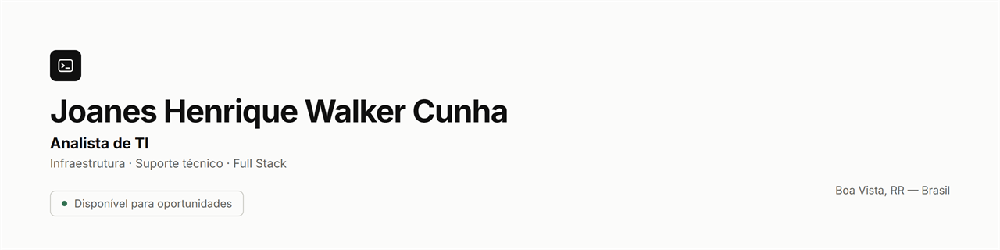

  

  <a href="https://henriquewalker31.github.io/">Portfólio</a> ·
  <a href="https://linkedin.com/in/jhenriquewc">LinkedIn</a> ·
  <a href="mailto:joaneshwc31@gmail.com">E-mail</a>

## Sobre mim

Analista de TI em Boa Vista (RR), com experiência em infraestrutura, suporte técnico e desenvolvimento full stack. Liderei a modernização do sistema interno de atendimento da Hemissul — mais de 4 mil chamados em seis meses — e participei da implantação da tecnologia de uma nova unidade de saúde.

## Projetos

| Projeto | Descrição | Stack |
| --- | --- | --- |
| [Sala Escura](https://github.com/Henriquewalker31/Sala-Escura) | Catálogo de filmes full stack integrado ao TMDB, com cache e filtros | Python · FastAPI · JavaScript |
| [PIGZ](https://github.com/Henriquewalker31/pigz-fipe-api) | API de veículos e Tabela FIPE com token, permissões e comparação de preços | PHP · Symfony · MySQL · Docker |
| [Sistema de Livraria](https://github.com/Henriquewalker31/Sistema-Livraria) | CRUD de livraria com busca, cadastro e edição | PHP · MySQL · Bootstrap · Docker |
| [AutoViagem](https://github.com/Henriquewalker31/Auto-Viagem) | App desktop para calcular autonomia e custo de combustível | Electron · JavaScript |

## Stack

**Infraestrutura** — Windows · Redes · Microsoft 365 · Hardware  
**Desenvolvimento** — Python · PHP · JavaScript · FastAPI · Symfony · Electron  
**Dados e ferramentas** — PostgreSQL · MySQL · Docker · Git

## Experiência

**Suporte de TI — Hemissul Proteção Veicular** · set. 2026 – atual  
Suporte e infraestrutura, administração de Microsoft 365, CRMs e sistemas internos. Liderei a modernização do sistema de atendimento: gestão de usuários, setores, filas e permissões, interface responsiva e o design da empresa.

**Suporte de TI (estágio) — Prefeitura de Boa Vista** · fev. 2026 – jul. 2026  
Atendimento em mais de 30 unidades de saúde, manutenção de equipamentos e implantação da infraestrutura de TI de uma nova UBS.

## Formação

Tecnólogo em Análise e Desenvolvimento de Sistemas — Claretiano (2024–2026)  
Capacitação em IA, Indústria 4.0 e Inovação — UFRR (2024)

---

> "Recomendo seu trabalho pela competência técnica, pela postura profissional e, principalmente, pelo potencial de crescimento que demonstra a cada nova entrega."  
> — Lucas Alves, gestor na Hemissul

  Disponível para oportunidades CLT e remotas · Boa Vista, RR

